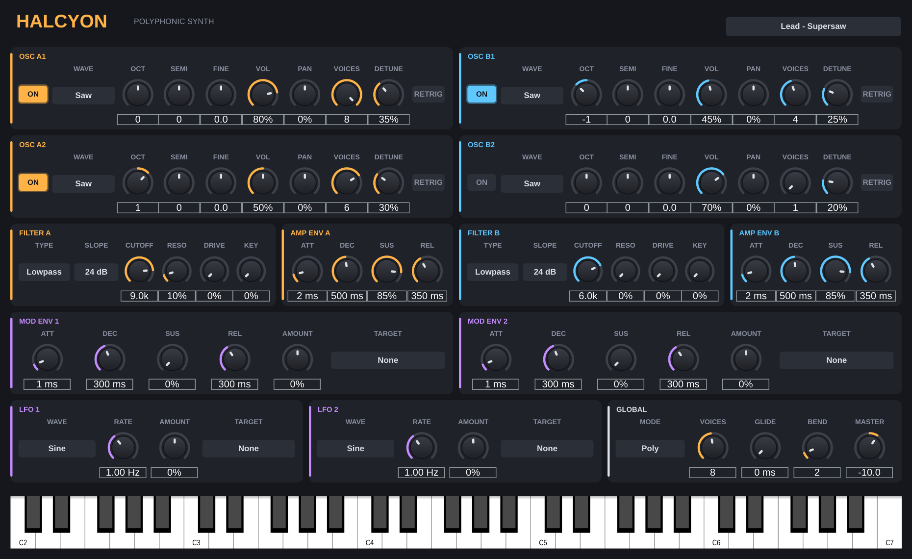
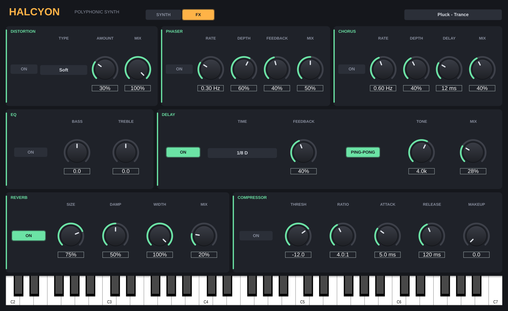
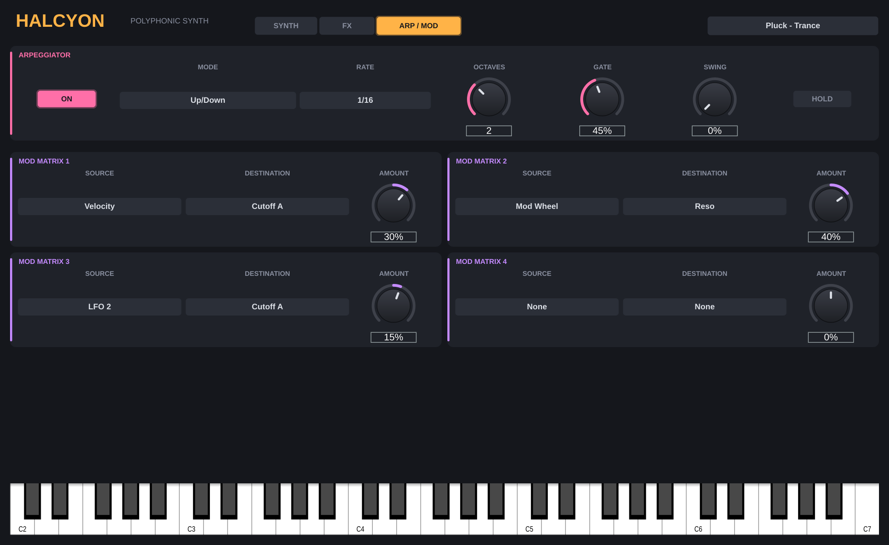

# Halcyon — polyphonic synth (VST3 / AU / Standalone)

An original subtractive polysynth built with JUCE. Stages 1–3: core synth, effects rack, arpeggiator and mod matrix.





## Architecture
- **4 oscillators in two parts**: A1 + A2 feed Filter A, B1 + B2 feed Filter B
- Each oscillator: saw, pulse, triangle, sine, noise; octave, semitone, fine; volume, pan;
  **up to 8 unison voices** with detune and automatic stereo spread; free-running or retriggered phase
- **2 filters**: lowpass / bandpass / highpass, 12 or 24 dB, cutoff, resonance, drive, key tracking
  (zero-delay-feedback state-variable design)
- **Amp envelope per part** (ADSR)
- **2 mod envelopes and 2 LFOs** (sine, triangle, saw, square, S&H), each with amount and a target:
  cutoff A / B / both, pitch all / A / B, resonance, pan, volume
- **16-voice polyphony**, Poly / Mono / Legato modes, portamento (also in poly), pitch bend range
- On-screen keyboard; 7 factory presets (Init, Lead - Supersaw, Pluck - Trance, Pad - Warm,
  Bass - Reese, Stab - Melodic, Arp - Melodic Sequence); everything saves with your project

- **Effects rack** (FX tab), in signal order:
  - Distortion: soft, hard, fold, crush (bit + sample rate), amount, mix
  - Phaser: 6 stages, stereo, rate, depth, feedback, mix
  - Chorus: stereo, rate, depth, delay, mix
  - EQ: bass and treble shelves (±15 dB)
  - Delay: tempo-synced (1/16 to 1/2, dotted and triplet), feedback, ping-pong, tone, mix
  - Reverb: size, damping, width, mix
  - Compressor: threshold, ratio, attack, release, makeup (stereo-linked, soft knee)

- **Arpeggiator** (ARP / MOD tab): Up, Down, Up/Down, As Played, Random, Chord; 1/4 to 1/32 including
  triplets; 1–4 octaves; gate; swing; hold (latch). Syncs to the host transport, or runs from its own
  clock (restarted on the first key) when the host is stopped.
- **Mod matrix**: 4 slots of source -> destination with a bipolar amount.
  Sources: velocity, mod wheel, aftertouch, key, LFO 1/2, mod env 1/2, random (per note).
  Destinations: cutoff A / B / both, pitch all / A / B, resonance, pan, volume, unison detune,
  filter drive, part A/B balance.

Worst case (16 voices x 4 oscillators x 8 unison = 512 oscillators) uses about 25% of one CPU core; the full effects rack adds about 4%.

## Roadmap
- Stage 4: preset import (needs reference preset files from a licensed copy of the original synth)

## Build
Push to GitHub and the included Actions workflow builds Windows, macOS and Linux, or:
```
cmake -B build -DCMAKE_BUILD_TYPE=Release
cmake --build build --config Release
```
Engine-only test (no JUCE): `g++ -O2 -std=c++17 tests/engine_test.cpp -o et && ./et`

## License note
JUCE 8 is AGPLv3 or commercially licensed (free tier for small developers).
